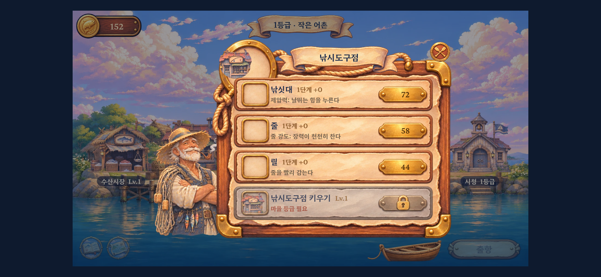
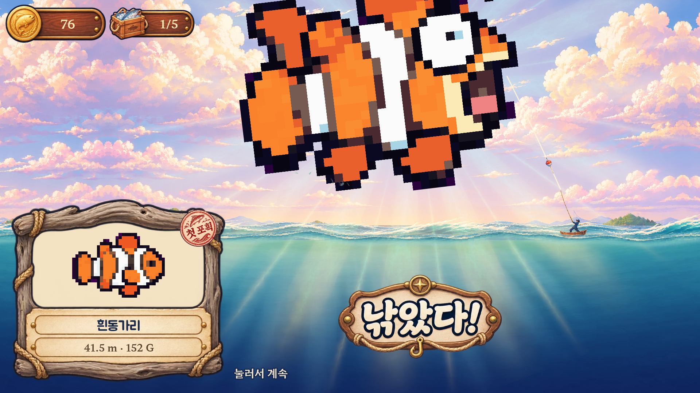
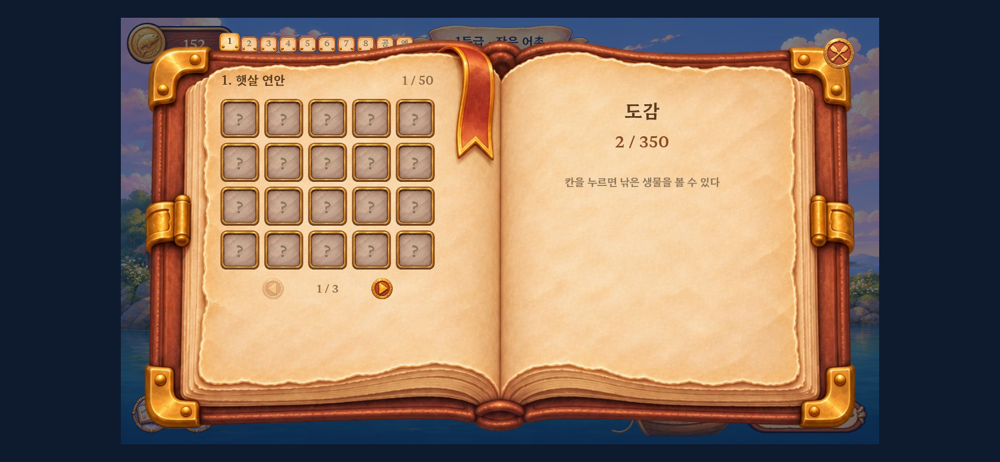

# 호라이의 수평선 — APK 검수 및 개선 제안

검수일: 2026-11-12

대상: 사용자가 전달한 `hori-horizon.apk`, 버전 `0.1` / versionCode `1`

패키지: `com.horizonangler.game`

> **이 보고서는 전달받은 APK에 포함된 게임을 검수한 결과입니다. 현재 GitHub main 또는 개발 브랜치의 최신 코드에 같은 문제가 남아 있다는 의미는 아닙니다. 아래 파일명과 행 번호는 APK의 `assets/public/`에서 추출한 버전을 기준으로 합니다.**

## 1. 전달 요약

바다와 항구의 따뜻한 분위기, 작은 배와 큰 생물의 대비, 수집과 마을 성장의 연결은 잘 살아 있다. 수정 우선순위는 **유물·엔딩 저장 → 빈 장비 아이콘 → 포획 화면 구도 → 강화 체감과 설명 → 모바일 조작성**이다.

생물의 귀여운 도트 표현은 유지하는 방향을 권한다. 완성도를 높이는 방법을 도트 수 증가로 한정하지 말고, 구도·표정·색온도·외곽선·효과의 강약부터 조정한다.

| ID | 우선순위 | 구분 | 발견 사항 | 확인 수준 |
|---|---|---|---|---|
| R01 | P1 | 저장/진행 | 마지막 유물 직후 종료하면 기억·엔딩 장면을 놓칠 수 있음 | 후반 상태를 설정한 재시작 검사로 재현 |
| R02 | P2 | 자산 연결 | 상점의 장비 아이콘이 빈칸으로 표시됨 | 화면 및 자산 목록 확인 |
| R03 | P2 | 화면/연출 | 결과 화면에서도 생물 윗부분이 잘림; 축소 시 하늘 반복이 드러남 | 포획 상태 진행 및 화면 확인 |
| R04 | P2 | 성장/설명 | 배·줄 강화의 실제 효과와 구매 설명이 어긋남 | 구매 및 수치 비교 |
| R05 | P2 | 조작/보상 | 멀리 던질수록 부담은 늘지만 보상이 없음 | 코드 확인 및 보조 시뮬레이션 |
| R06 | P2 | 모바일 UI | 도감 탭과 설명 글씨가 작음 | 844×390 CSS 화면에서 확인 |
| R07 | P2 | 설정 | 음소거 설정이 재시작 후 초기화됨 | 재시작 검사로 재현 |
| R08 | P3 | 아트 개선 | 도트 생물과 세밀한 배경·금색 UI 사이의 질감 차이 | 시각적 개선 제안 |
| R09 | P2 | 성능 검증 | 첫 화면에서 읽는 이미지와 분리 캔버스의 규모가 큼 | 정적 산출; 실기기 메모리 미측정 |
| R10 | P3 | 배포 준비 | 테스트 서명 및 디버그 설정의 APK | APK 메타데이터 확인 |

P1은 진행 보존 문제, P2는 플레이 품질 또는 출시 전 검증 우선 항목, P3는 완성도·배포 준비 항목이다. 개선 제안은 구현 확정 사항이 아니다.

## 2. 검수 방법과 한계

- APK 내부 웹 자산을 그대로 추출해 Chromium에서 실행했다. 화면 크기는 960×540 및 844×390 CSS px, devicePixelRatio는 2였다.
- 첫 실행, 대화, 출항, 캐스팅, 입질, 파이팅, 포획, 유물 기억, 항구 판매, 상점, 도감을 확인했다. 반복·후반 검사는 게임이 제공하는 수동 프레임 진행과 테스트 상태 설정을 사용했다.
- 일반 포획과 환상종 포획을 확인했다. 모든 생물을 직접 낚거나 모든 해역의 성장 과정을 끝까지 플레이한 검수는 아니다.
- 후반 저장 검사는 실제 저장·복원 코드와 결과 입력 처리기를 사용하되, 마지막 유물 직전 상태를 설정해 수행했다.
- AndroidManifest와 서명을 검사했다. **안드로이드 기기에 APK를 설치하거나 네이티브 실행을 하지는 못했다.**
- 실기기의 뒤로가기, 홈 전환, 노치·시스템 바, 터치 지연, 진동, 발열, 배터리, 저사양 프레임률은 미확인이다. 음악·효과음을 직접 듣고 평가하지도 못했다.
- 전체 약 3시간 진행, 해역별 20~30분, 구매 간격 약 16초라는 목표의 달성 여부는 이번 검사로 보증하지 않는다.
- 추출한 게임 파일 132개를 APK 원본과 바이트 단위로 비교했으며 변경된 파일은 없다. 이 보고서 전달 커밋도 게임 코드를 수정하지 않는다.

APK SHA-256:

```text
89953e768eb2959690bef0b59e3146057f3fdef7bd43c8c5f992abcf8dc750ce
```

## 3. 수정 항목

### R01 · P1 · 유물 개수만 저장되어 마지막 기억과 엔딩이 이어지지 않음

**위치:** `src/game.js:158`, `src/main.js:89`, `src/main.js:94`, `src/story.js:198`, `src/story.js:211`

환상종 결과에서 놓아주기를 누르면 유물 개수를 먼저 증가시키고 `memoryNext`를 설정한다. 저장 데이터에는 `relics`가 포함되지만 `memoryNext`, 진행 중인 `memory`는 포함되지 않는다. 마지막 기억을 마쳐야 연결되는 엔딩 장면도 이 경로에 의존한다.

**재현 조건:** 유물 11개를 가진 상태에서 환상종을 낚고 놓아주기 → 12번째 유물을 받음 → 기억 장면 전 또는 도중에 종료 → 재실행. 이때 마지막 유물은 이미 소유한 것으로 복원되지만 미완료 장면이 복원되지 않는다. 유물을 전부 가진 뒤에는 새로운 유물 획득으로 이 장면을 다시 시작할 수도 없다.

검사 결과:

```text
종료 전: relics=12, memoryNext=11, finale=false
저장값: relics=12, memoryNext 및 memory 없음
복원 후: relics=12, memoryNext=null, memory=null, finale=false
```

**수정 제안:** 보상 소유 상태와 장면 완료 상태를 분리한다. 미완료 기억의 번호와 엔딩 진행/완료 상태를 저장하고, 로드 시 미완료 장면을 다시 시작한다. `finale` 완료 표시는 장면 시작이 아니라 마지막 문장을 마친 뒤 기록한다. 이미 영향을 받은 저장도 `relics >= 12`와 장면 완료 상태로 복구할 수 있게 한다.

**완료 기준:** 유물 획득 직후, 기억 도중, 엔딩 도중 각각 종료·재실행해도 장면을 이어 보거나 처음부터 다시 볼 수 있다. 유물과 보상은 중복 지급되지 않는다.

### R02 · P2 · 장비 아이콘 40개가 자산 목록에 연결되어 있지 않음

**위치:** `src/harbor.js:111`, `src/harbor.js:277`, `src/assets.js:193`, `assets/game/manifest.json`

상점은 `h_rod_1`, `h_line_1`, `h_reel_1` 같은 이름을 요청한다. APK의 자산 목록에는 `h_{outfit,reel,line,rod,boat}_{1..8}` 총 40개 이름이 없다. 없는 그림은 투명 이미지로 대체되므로 예외 없이 빈칸으로 나타난다. 낚시도구점의 세 장비와 조선소의 배 아이콘에서 직접 확인했다.

등록된 파일의 실물 누락은 없었다. **자산 목록에 등록된 파일이 없는 문제와, 코드가 요청하는 이름 자체가 목록에 없는 문제를 구분해야 한다.**

**수정 제안:** 상점 아이콘 이름을 실제 자산 키에 연결한다. 그림이 준비되지 않은 항목에는 의미를 알아볼 수 있는 임시 아이콘을 표시한다. 5종×8단계의 동적 이름을 전부 검사하는 자산 검증을 추가한다.

**완료 기준:** 모든 장비 단계의 상점을 열었을 때 아이콘이 보이고, 해당 이름이 `window.__missing`에 추가되지 않는다.



### R03 · P2 · 포획 결과의 생물 잘림과 하늘 반복

**위치:** `src/game.js:634`, `src/game.js:357`, `src/render.js:489`, `src/render.js:513`, `src/render.js:320`

근접 촬영 후 카메라가 물러난 결과 화면에서도, 흰동가리와 해님가오리의 일부 펄떡임 프레임에서 윗부분이 화면 밖으로 잘렸다. 크기 맞춤은 주로 기본 그림의 비율을 사용하지만 실제 렌더링에는 놀람 그림의 높이, 회전, 튀는 이동량과 확대가 더해진다.

**수정 제안:** 기본/놀람 그림 및 모든 펄떡임 자세를 포함한 최대 표시 범위를 구한다. 결과 화면에서는 위쪽 UI 여백을 제외한 영역 안에 전신이 들어오도록 최종 줌과 중심을 계산한다. 근접 연출 중 의도한 잘림과, 전신을 보여주는 결과 화면의 잘림은 별도로 처리한다.

큰 축소에서 하늘을 좌우 반전해 반복하는 이음도 두드러지고, 구름이 세로로 늘어난 인상을 준다. 하늘의 가로·세로 비율을 유지하고 구름·섬 레이어의 패럴랙스와 반복 경계를 조정한다.

**완료 기준:** 일반·환상종, 가로형·세로형 생물의 전체 동작 주기에서 결과 전신과 얼굴이 보인다. 일반 → 근접 → 전신 구도 전환에서 하늘의 대칭 이음이 눈에 띄지 않는다.



### R04 · P2 · 배·줄 강화의 체감 공백과 설명 불일치

**위치:** `src/economy.js:18`, `src/economy.js:68`, `src/economy.js:69`, `src/game.js:394`, `src/harbor.js:111`

배 +1 구매에 87G가 실제 차감되어 152G → 65G가 됐지만 어창은 5칸 그대로였다. +1~+9에서는 어창과 해역이 바뀌지 않고, 10번째 구매에서 7칸 및 2해역이 열린다. 설명은 중간 단계에서도 계속 `어창 +2 · 다음 해역`이다. 단계 해금을 위한 투자일 수 있으나, 이번 구매의 효과처럼 보인다.

줄의 장력 증가 계수는 아래처럼 하한에 도달한다. 하한 이후의 강화는 다음 해역 대비에는 의미가 있지만 현재 해역에서는 같은 계수를 사용한다.

| 1해역 줄 강화 | 적용 계수 K | 현재 해역의 변화 |
|---|---:|---|
| +0 | 1.0000 | 기준 |
| +1 | 0.8706 | 장력이 덜 참 |
| +2 | 0.7579 | 장력이 덜 참 |
| +3 | 0.7500 | 아주 작은 추가 변화 |
| +4~다음 단계 | 0.7500 | 계수 변화 없음 |

**수정 제안:** 구매창에 현재 → 다음 효과와 단계 해금까지 남은 횟수를 표시한다. 배는 `2단계까지 9회 · 달성 시 어창 5→7 / 2해역 해금`처럼 실제 조건을 안내한다. 줄은 현재 해역 효과의 상한과 다음 해역 대비임을 표시하거나, 강화 곡선을 조정해 중간 구매에도 변화가 있게 한다.

**완료 기준:** 구매 전에 즉시 효과와 장기 해금 효과를 구분할 수 있다. 현재 해역에서 효과가 없는 강화에 같은 효능 문구를 반복하지 않는다.

### R05 · P2 · 긴 캐스팅의 위험에 대응하는 보상이 없음

**위치:** `src/game.js:177`, `src/game.js:389`, `src/game.js:416`, `src/game.js:473`, `src/creatures.js:54`

파워를 높이면 줄다리기의 시작 거리가 `30 + power × 50`으로 증가하고 최소 대기시간도 늘어난다. 반면 어종·등급·크기·가격 추첨에는 캐스팅 파워가 전달되지 않는다. 따라서 힘 조절을 익힐 보상보다 빨리 짧게 던질 유인이 크다.

보조 검사에서는 초반 장비·일반 등급을 고정하고, 장력과 날뛰기 상태를 읽는 자동 입력으로 파워 0/1을 각각 30회 진행했다. 실제 사용자의 성공률을 뜻하지 않는다.

| 조건 | 결과 화면 도달 | 성공한 시도 평균 시간 |
|---|---:|---:|
| 파워 0 | 30/30 | 약 21.3초 |
| 파워 1 | 21/30 | 약 32.3초 |

시간은 캐스팅 시작부터 결과 화면까지이며 충전 시간, 결과 확인 후 입력, 항구 왕복은 제외했다. 난수를 고정하지 않은 소규모 보조 검사이므로 전체 밸런스의 근거로 확대 해석하면 안 된다. 핵심 근거는 긴 캐스팅의 보상이 추첨식에 연결되어 있지 않다는 점이다.

**수정 제안:** 캐스팅 거리 또는 좋은 투척 구간에 희귀도·큰 개체 등 보상을 연결하는 기획을 확정한다. 긴 캐스팅에 별도 보상을 주지 않을 계획이면, 불필요한 충전을 유도하는 안내와 게이지의 역할을 재검토한다.

**완료 기준:** 단거리와 장거리 사이에 플레이어가 선택할 이유가 있고, 그 차이가 화면 설명과 실제 추첨식에 모두 반영된다.

### R06 · P2 · 모바일 도감 탭과 작은 글씨

**위치:** `src/main.js:15`, `src/book.js:92`, `src/book.js:122`, `src/harbor.js:280`, `src/harbor.js:281`

844×390 CSS 화면에서 실제 게임 캔버스는 정수 배율 선택으로 640×360 CSS px로 표시됐다. 도감의 탭은 약 16px 폭이고, 글씨는 일부 7~9px이다. 손가락으로 탭을 구분하기 어렵고 장비 설명을 읽기 위해 화면을 가까이 봐야 한다. 가로 여백 중 일부는 16:9 화면 비율 유지에 따른 정상 여백이다.

**수정 제안:** 주요 터치 영역은 44~48 CSS px 정도를 목표로 확보한다. 도감 탭은 가로 스크롤·묶음 선택 등으로 바꾸어 넓힌다. 작은 화면에서는 설명을 줄이거나 상세창으로 분리하고 실제 표시 글자 크기를 키운다. 세계의 도트 배율과 UI 표시 배율을 분리하는 방법도 검토한다.

**완료 기준:** 844×390 및 더 작은 지원 기기에서 이웃 탭 오입력 없이 이동할 수 있고, 설명·가격·잠금 조건을 확대 없이 읽을 수 있다.



### R07 · P2 · 음소거 설정 미저장 및 플레이 중 접근성

**위치:** `src/audio.js:400`, `src/audio.js:410`, `src/story.js:148`, `src/main.js:89`

소리를 끈 뒤 재실행하면 `soundOn()`이 다시 `true`가 된다. 소리 설정은 모듈 변수에만 있고 저장 대상이 아니다. 앱에서 보이는 음소거 조작은 제목 화면에 있어 플레이 도중 접근하기도 어렵다.

**수정 제안:** 음소거 상태를 별도 설정 키로 저장·복원한다. 플레이 중 열 수 있는 작은 설정 메뉴를 마련하고 필요하면 BGM·효과음 볼륨을 분리한다.

**완료 기준:** 음소거 후 종료·재실행 및 앱 전환에도 설정이 유지된다. 플레이 중 낚시 진행을 잃지 않고 소리를 조절할 수 있다. 실제 소리의 음질·음량 밸런스는 실기기 청취로 별도 검증한다.

### R08 · P3 · 도트 생물과 배경·UI의 질감 조율

**대상:** `assets/game/d_atlas.png`, 배경 `c_sky*`·`c_sea*`, `ui_big.webp`·`ui_extra.webp`, 포획 결과 화면

생물은 단순하고 굵은 도트 형태인 반면 배경과 금색 UI는 세밀하고 광택이 강하다. 특히 큰 포획 화면에서 생물을 별도로 붙인 인상이 있고, 화려한 현판이 생물보다 먼저 눈에 들어오는 순간이 있다. 기능 오류가 아닌 시각적 개선 제안이다.

**수정 제안:** 귀여운 체형·표정과 현재 도트 수는 유지한다. 외곽선의 검정/남색, 밝은 면의 색온도, 명암 단계와 광원 방향을 맞춘다. 일반 포획은 현판 크기·빛·플래시를 줄이고 높은 등급에서 강조해 보상 차이를 만든다. 최종 카메라 구도부터 수정한 뒤 아트를 재평가한다.

**완료 기준:** 같은 화면 안에서 생물·배경·UI가 한 게임의 그림처럼 보이고, 포획 순간 생물의 얼굴과 실루엣이 먼저 읽힌다.

### R09 · P2 · 시작 이미지 메모리 규모와 실기기 성능 검증

**위치:** `src/assets.js:144`, `src/assets.js:164`, `src/assets.js:181`

시작할 때 생물 이외의 자산을 한꺼번에 읽고 아틀라스의 개별 그림을 각각 캔버스로 복사한다. 시작 대상의 고유 이미지 109개는 압축 파일 합계 약 17.0MB, 4바이트 RGBA 환산 약 268.8MB다. 아틀라스 분리용 캔버스 183개는 같은 방식으로 약 58.3MB다.

**이 값은 픽셀 크기를 이용한 산출값이며, 실제 안드로이드 프로세스 메모리나 GPU 사용량을 측정한 값이 아니다. 실제 크래시·발열이 재현됐다는 뜻도 아니다.** 다만 저사양 기기 검증이 필요한 규모다.

**수정 제안:** 현재 해역과 다음에 필요한 해역, 현재 마을·장비 단계부터 읽도록 나눈다. 가능하면 원본 아틀라스의 영역을 직접 그려 중복 캔버스를 줄인다. 시작 로딩 표시와 실패 대응도 준비한다.

**완료 기준:** 지원 최저 사양의 실기기에서 첫 화면 시간, 최대 메모리, 연속 낚시 프레임률, 앱 복귀와 장시간 발열을 측정한다. 계측 전에는 60fps나 저사양 지원을 통과 처리하지 않는다.

### R10 · P3 · 정식 배포 전 빌드 설정 확인

**위치:** APK `AndroidManifest.xml`, APK 서명 인증서

`android:debuggable="true"`, 인증서 CN은 `Horizon Angler Test`다. 시험 배포용 APK라면 자연스러운 상태이며 게임 플레이 버그로 분류하지 않는다. minSdk는 24, targetSdk는 36이고 화면 방향은 sensorLandscape로 설정돼 있다.

**수정 제안:** 정식 배포 시 디버그 설정을 끄고 정식 서명 및 버전 관리 방침을 적용한다. 업데이트 설치에서 기존 저장이 유지되는지도 확인한다.

## 4. 이번 검사에서 정상 확인한 부분

- 첫 실행, 대화, 출항과 기본 낚시 흐름에서 JavaScript 예외를 발견하지 않았다.
- 확인한 일반 포획에서는 값의 절반이 선금으로 지급되고, 항구에서 나머지가 지급되며 어창이 비워졌다. 선금 지급은 현재 APK의 명시적인 동작이므로 항구 판매 규칙 위반으로 보고하지 않는다.
- 재시작 후 골드 12,345G, 어창 1개, 낚싯대 레벨 3, 물고기 기록이 검사값 그대로 복원됐다. 이것이 모든 중단 시점의 저장 안전성을 보증하지는 않는다.
- 자금 부족 구매, 마을보다 높은 가게 구매, 조선소 조건을 충족하지 않은 배 단계 상승, 도감 조건을 충족하지 않은 마을 4등급 상승, 잠긴 해역 선택이 차단됐다. 모든 우회 경로를 검사한 보안 감사는 아니다.
- 자산 목록에 등록된 파일 경로는 모두 존재했다. R02는 코드의 동적 이름과 목록 사이의 연결 누락이다.

## 5. 권장 작업 순서와 전달 자료

1. R01 저장 복구를 먼저 수정하고, 이미 유물 12개를 가진 저장의 엔딩 복구까지 확인한다.
2. R02 자산 연결과 R03 최종 카메라 구도를 수정한다.
3. R04 강화 설명/효과와 R05 투척 보상을 기획에 맞게 확정한다.
4. R06 모바일 조작 및 R07 설정 보존을 수정한다.
5. R08 그림 간 조율을 진행하고 R09·R10을 실기기·배포 빌드에서 확인한다.

이전 [REVIEW_01.md](REVIEW_01.md)는 별도 검수 기록이다. 이번 문서와 대상 버전이 다를 수 있으므로 발견 사항을 자동 합산하거나 최신 코드의 잔존 버그로 단정하지 않는다.

증거 자료:

- [APK 식별 및 검수 환경](evidence/review_02_apk/review_evidence.json)
- [저장·구매 제한·강화 계수 검사 결과](evidence/review_02_apk/checks_results.json)
- [캐스팅 보조 검사 원자료](evidence/review_02_apk/cast_results.json)

`checks_results.json`의 `manifestMissing`은 상점을 열기 전의 값이다. R02의 장비 아이콘 누락은 이후 상점 화면과 자산 키 전체 대조로 확인했다. 검사 원자료의 상태 설정값은 사용자의 실제 플레이 저장이 아니다.
