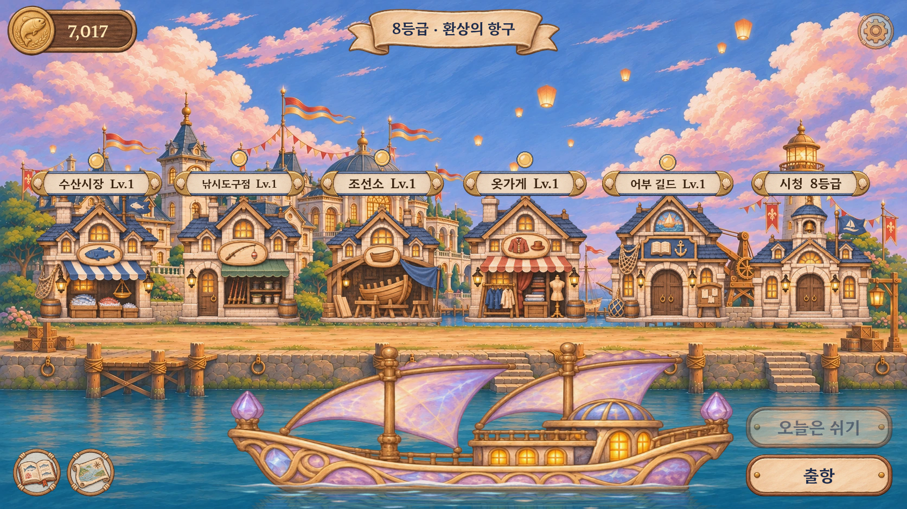
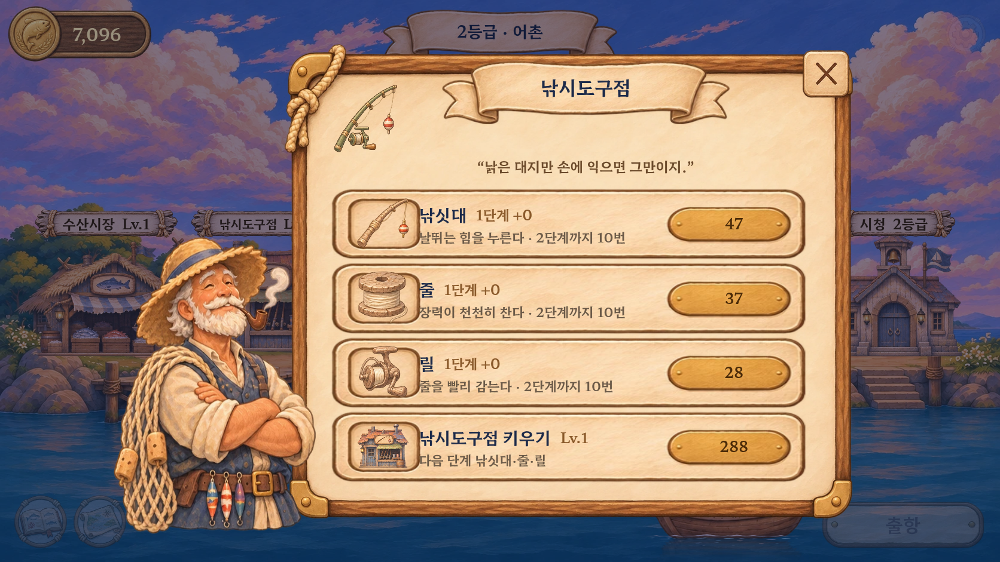
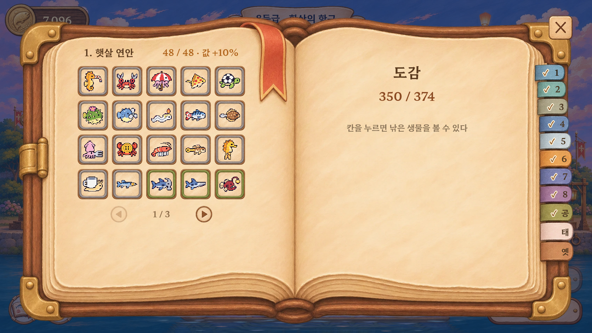
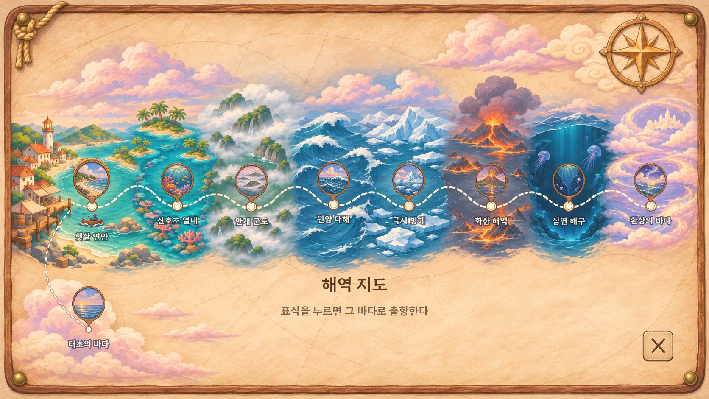

# 동화책 항구·NPC·UI 적용

기준: `claude/amazing-mendel-8fufxr`의 `87a8358c0202c3b511c5e3601502b164085b3946`.

사용자가 승인한 동화책 분위기를 항구와 공통 UI에 적용했다. 큰 금장 원틀을 덜어내고 크림빛 종이, 갈색 나무, 부드러운 붓결로 연결했다. NPC는 원래 인물·직업 소품을 유지하면서 표정과 형태를 정돈했다.

## 반영 범위

- 항구 배경 5단계, 건물 6종 × 5단계, NPC 6명.
- 항구에 정박한 배 9단계. 크게 보이는 중·후반 배 6척은 별도의 큰 원화로 준비했다.
- 가게·설정 공통 판, 구매 줄과 버튼, 간판, HUD, 설정·기술·장비 아이콘.
- 도감 책과 칸, 결과 카드 7등급, 해역 지도와 표식.
- 합계 182개 그림. 29개 원화 PNG와 재생성 도구를 함께 저장했다.

게임 내 도트 생물, 바다 장면과 낚기 연출, BGM, 구매 가격·해금 조건·저장 형식은 변경하지 않았다.

## 화면 배치

- 가게 판 위쪽의 큰 원형 장식을 작은 직업 상징으로 바꿨다.
- NPC를 판 앞에 배치하고 표시 높이를 맞춰 팔이 판 뒤에 잘리지 않게 했다.
- 새 도감 꼬리표와 해도 항로 점에 클릭 위치를 맞췄다. 도감 강조 조각의 가로·세로 비율을 따로 계산해 잘못된 부분을 복사하는 문제를 막았다.
- 도감을 완성한 해역은 원래 탭 색을 유지하고 작은 확인 표시를 붙인다. 태초 탭은 해금 뒤에만 나타난다.
- 결과 카드의 투명 창을 다시 측정해 생물이 틀 안에 놓이게 했다.

## 실제 게임 화면

생성 시안이 아니라 Chromium에서 게임을 실행해 캡처했다. 성장 단계·도감 상태를 비교하기 위해 검수용 진행 상태를 사용했다.

## 확인한 것

- `tools/audit_storybook.cjs`: 59개 조작 검사 통과. 가게 6곳 열기·닫기, 구매 시 정확한 차감과 단계 상승, 구매 제한, 설정 쪽 전환·음량, 지도 9해역 이동과 미해금 지역 차단, 도감 해금 전후 탭, 생물 선택, 모바일 비율 조작.
- 1672×941, 915×412, 640×360 화면 캡처. 항구 5단계, NPC 6명, 결과 카드 7종과 설정·지도·도감을 확인했다.
- 선택한 182개 외의 manifest 항목이 바뀌지 않았고 논리 크기·기준점 등 기존 메타데이터가 유지되는지 확인했다. 묶음 그림의 경계 초과와 비어 있는 칸이 없다.
- `npm run www` 성공. 배포용 묶음에서도 그림 누락·페이지 오류 없이 실행되고 도감 11개 탭이 동작한다.
- 검사 기록: [조작 검사](storybook/report.json), [배포 묶음 검사](storybook/build-report.json).

Android 실기기, 실제 터치 감도와 장시간 프레임·발열은 확인하지 않았다. APK는 만들지 않았다.

재생성·수정 방법은 [원화 안내](../assets/raw/storybook/README.md)를 참고한다.
